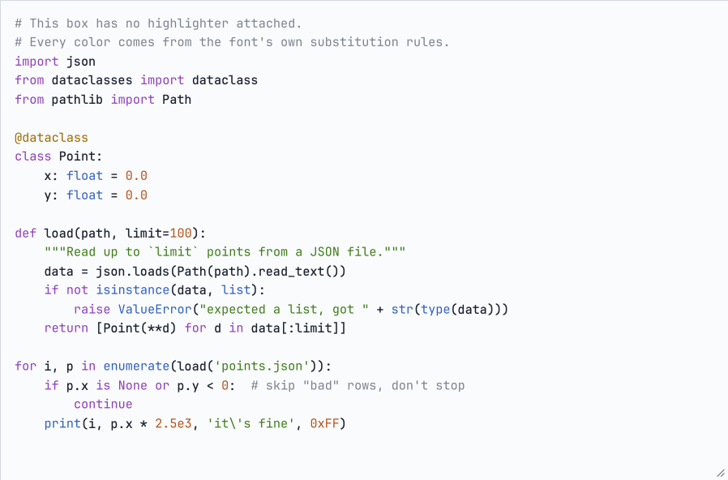
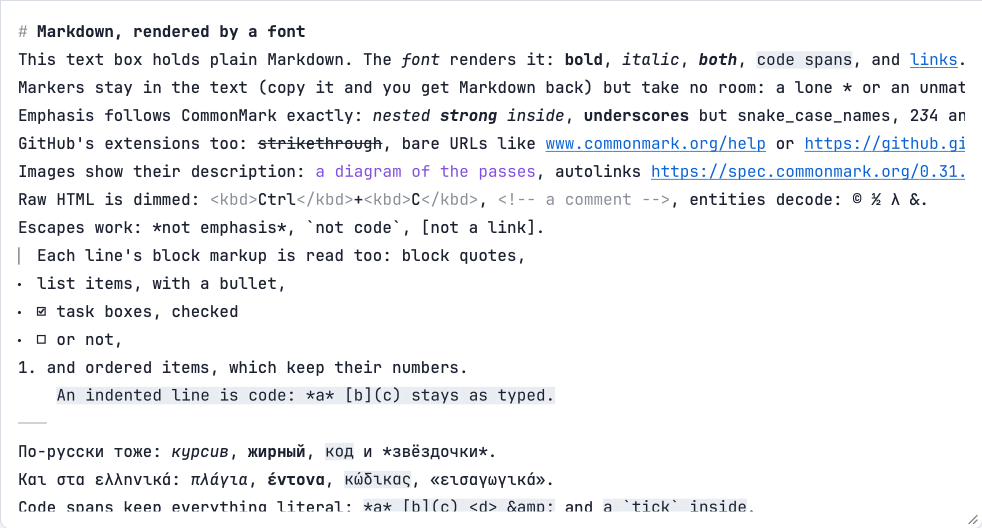
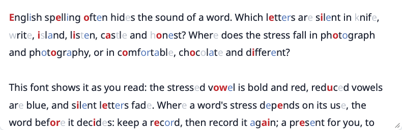
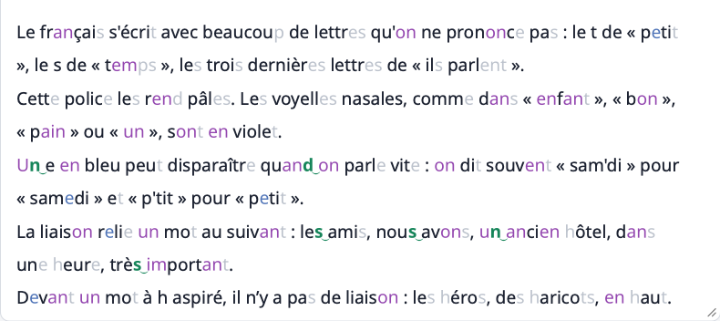
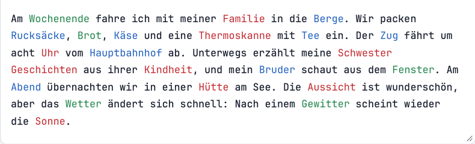
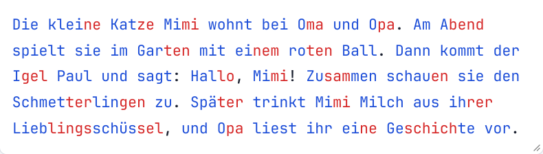

# Fontlex

**Compilers that target fonts.** Fontlex turns a lexer, a Markdown grammar
or a pronunciation dictionary into an OpenType font, and the text shaper
that every browser and operating system already has runs it. Type into a
plain `<textarea>` and the font highlights Python, renders Markdown as you
type, or shows a learner how French words are said. No editor plugin, no
JavaScript: the font's substitution rules do it.

[](https://github.com/fMindstormer/fontlex/actions/workflows/checks.yml)
[](LICENSE)

**[Try the live demos](https://fmindstormer.github.io/fontlex/)** · [Download the fonts and the browser extension](https://github.com/fMindstormer/fontlex/releases/latest)

<table>
<tr><td><a href="https://fmindstormer.github.io/fontlex/python.html"></a></td>
<td><a href="https://fmindstormer.github.io/fontlex/markdown.html"></a></td></tr>
<tr><td><a href="https://fmindstormer.github.io/fontlex/english.html"></a></td>
<td><a href="https://fmindstormer.github.io/fontlex/french.html"></a></td></tr>
<tr><td><a href="https://fmindstormer.github.io/fontlex/german.html"></a></td>
<td><a href="https://fmindstormer.github.io/fontlex/german-syllables.html"></a></td></tr>
</table>

Every image is a plain text box; the colors, the hidden Markdown markup and
the liaison ties are drawn by the font.

## The fonts

| Font | What the shaper does | Measured |
|---|---|---|
| [Python](https://fmindstormer.github.io/fontlex/python.html), [JavaScript](https://fmindstormer.github.io/fontlex/javascript.html) | runs a lexer compiled from a YAML spec ([below](#the-spec)) and colors each token | every glyph's state matches a reference lexer: 20,000 random strings, every transition, every spec example; HarfBuzz and Core Text |
| [Markdown](https://fmindstormer.github.io/fontlex/markdown.html) ([README](markdown/README.md)) | renders GitHub Flavored Markdown line by line: CommonMark's inline rules, strikethrough, autolinks, block markup; markup hidden; mono and proportional | within its bounds, every one-line spec example, 20,000 random lines and 10,723 lines of real documents exactly as GitHub renders them |
| [German genders](https://fmindstormer.github.io/fontlex/german.html) ([README](german/README.md)) | colors nouns by gender, from lists learned from a treebank and Wiktionary | on held-out newspaper text, 97% of nouns colored, 99.5% of them right |
| [German syllables](https://fmindstormer.github.io/fontlex/german-syllables.html) ([README](german/syllables/README.md)) | colors syllables in turn, as German schools teach reading | 97.5% of held-out first-reader words split exactly right |
| [English pronunciation](https://fmindstormer.github.io/fontlex/english.html) ([README](english/README.md)) | marks stressed and reduced vowels and silent letters of 30,000 words; noun/verb pairs read the word before (*the record*, *to record*) or an invisible [reading marker](markers/README.md); a stylistic set turns each kind of hint off | 170,817 of 170,817 cases right in HarfBuzz and Core Text |
| [French pronunciation](https://fmindstormer.github.io/fontlex/french.html) ([README](french/README.md)) | marks silent letters, nasal vowels, droppable schwas and obligatory liaison (*les‿amis*, but not *les héros*) for 30,000 words; reading markers as in English; a stylistic set turns each kind of hint off | 202,190 of 202,190 cases right in HarfBuzz and Core Text |
| [Browser extension](extension/README.md) | draws any web page in a learner font, matched to the page's language | 21 checks in Chromium and the same 21 in Firefox, including a page with a strict CSP and hiding each kind of hint |

## What's interesting here

- **Fonts are programs.** GSUB lookups compose into finite-state
  transducers. [theory/README.md](theory/README.md) works out what a font
  can compute (exactly the rational functions of a run) and measures the
  real budgets: glyph ids, the lookup list's 16-bit offsets, engine work.
  Fonts can't count, yet `theory/depth.py` matches brackets 4,000 deep.
- **Checked, not eyeballed.** Each font is compared glyph by glyph with a
  reference model in HarfBuzz (Chrome, Firefox, Android) and Core Text
  (Safari, macOS), and the demo pages are rendered in WebKit. CI rebuilds every
  font and page and fails unless the result matches the repository byte for
  byte.
- **It found an engine bug.** Compiled fonts reach glyph-id ranges that
  hand-drawn fonts don't. HarfBuzz 12.3.1 and later never match glyph ids
  32,512 to 32,767 in format 2 context rules. It was bisected to one commit
  and reported upstream
  ([harfbuzz/harfbuzz#6418](https://github.com/harfbuzz/harfbuzz/issues/6418)),
  and the fix was merged the same day
  ([#6419](https://github.com/harfbuzz/harfbuzz/pull/6419)).
- **Data, then compilation.** The learner fonts come from real data: hard-EM
  alignment of spellings with CMUdict and Lexique pronunciations, gender
  lists learned from a treebank, TeX hyphenation patterns. The pronunciation
  lexicons compile into class-based context rules, so their glyph count
  doesn't grow with the word list.
- **A font that can be told.** Where a font can't decide (is *record* a
  noun or a verb?), a tagger that reads the whole sentence puts an invisible
  variation selector after the word and the font draws that reading
  ([markers/](markers/README.md)). Other fonts show nothing. On the EWT
  treebank this settles 99.6% of English pair words, against 37.5% from the
  word before.

## Quick start

```sh
pip install -r requirements.txt
python fontlex.py specs/python.yaml --base fonts/JetBrainsMono-Regular.ttf --out build
python test_fontlex.py specs/python.yaml build/Fontlex-Python.ttf --base fonts/JetBrainsMono-Regular.ttf
python demo/build_demo.py specs/python.yaml --base fonts/JetBrainsMono-Regular.ttf --out demo/fontlex-demo.html
```

Then use the font in CSS:

```css
@font-face { font-family: "Fontlex Python"; src: url(Fontlex-Python.woff2) format("woff2"); }
textarea { font-family: "Fontlex Python", monospace; font-palette: light; }
```

`./check.sh` builds all eight fonts and the demo pages and runs every check
the machine supports; `./check.sh markdown` (or `unit`, `python`,
`javascript`, `german`, `syllables`, `english`, `french`, `extension`, `theory`) runs some of it.
On macOS, `pip install -r requirements-macos.txt` adds the Core Text
(Safari, native apps) and WebKit checks. The German treebank scores need
data that isn't in the repository (`german/fetch_ud.sh german/data`);
without it that step is skipped. A full run rebuilds every tracked font and
page byte for byte, so `git status` afterwards shows nothing.

## Layout

| Path | What it is |
|---|---|
| `fontlex.py`, `test_fontlex.py`, `specs/`, `demo/` | the lexer compiler, its tests, example specs, demo pages |
| `german/` | German noun gender (lists learned from a treebank and Wiktionary) and `german/syllables/` |
| `markdown/` | the GitHub Flavored Markdown font: model, compiler, verification, demo |
| `english/` | the English pronunciation-hint font: aligner, lexicon, compiler, verification, demo, review sheet |
| `french/` | the French pronunciation-hint font, with liaison: aligner, lexicon, compiler, verification, demo |
| `markers/` | invisible reading markers for noun/verb pairs, and a spaCy script that adds them |
| `extension/` | a browser extension that draws web pages in the learner fonts, with its Chromium and Firefox test |
| `docs/images/` | the screenshots above, of the demo pages in WebKit |
| `.github/workflows/` | CI (`./check.sh` on Ubuntu, byte-identical rebuild) and the GitHub Pages deploy |
| `theory/` | what font compilation can reach, with two experiments |
| `fonts/` | base fonts (JetBrains Mono, Noto Sans subset) and their licenses |
| `build/` | the compiled fonts, TTF and WOFF2 |
| `tests/` | unit tests (`python -m unittest discover -s tests`) |

### Compiler options

- `--unicodes U+0020-007E,U+00A0-024F,...` keeps only these characters of the
  base font. Every state that any character can enter (strings, comments)
  costs one variant glyph per character, so this is the main lever on glyph
  count and size. Keeping Latin, Greek, Cyrillic, combining marks,
  punctuation, arrows and math operators of JetBrains Mono (865 of its 1,363
  characters):

  | Font | Full base font | With `--unicodes` |
  |---|---|---|
  | Python | 6,207 glyphs, 112 KB WOFF2 | 3,868 glyphs, 62 KB |
  | JavaScript | 13,094 glyphs, 144 KB | 8,265 glyphs, 88 KB |

  Characters left out fall back to another font, which resets the lexer.
- `--unify-scripts` merges the base font's per-script positioning into one
  set used for all text. With some fonts, Core Text otherwise shapes each
  script as its own run and the lexer resets there (see Known limits); the
  compiler says so in `layout_notes`. The cost: every script gets every
  script's positioning, so Latin anchors also apply in Cyrillic-led text.

## The spec

`specs/python.yaml`, `specs/javascript.yaml`, `specs/german.yaml` and
`specs/german-syllables.yaml` are commented examples. A spec has:

- `classes`: named character classes (`"a-zA-Z_"`). Every other character in
  the base font falls into the implicit class `other`.
- `states`: a DFA. Each state has an optional `token`, an `on` map from class
  to next state, and either `default` (target for unlisted classes) or `like`
  (behave as another state for unlisted classes). An optional `lookahead`
  maps a next state to a state to draw this glyph in instead: in
  `javascript.yaml`, a `/` is redrawn as a comment once the next character
  shows it opened `//` or `/*`.
- `words`: word lists recolored when a whole run of glyphs in `words.state`
  spells one of them. Lists can be inline (`sets`) or in TSV files of
  `word<TAB>set` lines (`files`); a word listed twice keeps its first set, so
  an earlier file can override a later one. A set no theme colors (`none` in
  the German spec) leaves its words uncolored.
- `suffixes` (optional): endings that recolor a run of the same state that no
  listed word matched; the longest listed ending of the run decides. Same
  `sets` and `files` as `words`.
- `themes`: token colors. Each theme becomes a CPAL palette; themes named
  `light` and `dark` are tagged so CSS `font-palette: light|dark` picks them.
- `syllables` (optional, instead of a lexer): words, made of the characters
  of `letters` classes, split by TeX/Liang hyphenation patterns (`patterns`
  files), with `min_left`/`min_right` (1 or 2) forbidding breaks next to a
  word's edges, and colored with `colors` in turn, one per syllable.
- `examples` (optional): lines with the token expected for each character,
  written as a code string under a `legend`. The tests check the spec's lexer
  against them, which catches spec bugs that font-versus-spec checks can't.

The JavaScript spec shows what a DFA can do with context: it tells regex
literals from division by remembering whether a value (name, number, string,
closing bracket) came last, across spaces and comments, and handles `[...]`
and escapes inside regexes.

## How it compiles

1. **Variant glyphs.** For each (state, character) pair the DFA can produce,
   add `<glyph>.lx_<state>`, a composite of the original outline. The start
   state uses the original glyphs.
2. **Lexer lookup.** One chaining contextual GSUB lookup. Shapers let a rule's
   backtrack context see glyphs already replaced earlier in the same pass, so
   the previous glyph's variant carries the DFA state. Each table cell becomes
   `sub @S_<state> @C_<class>' lookup TO_<next>;`. Cells that agree with the
   start state's row are dropped, since the final no-context rules produce the
   same result.
3. **Lookahead.** If the spec uses `lookahead`, one more contextual lookup
   redraws a glyph based on the state of the glyph after it. GSUB applies each
   lookup to the whole run before the next, so this can't disturb the lexer.
4. **Words and suffixes.** A lookup marks the first glyph of every run of the
   word state with its own variant. Then each word and suffix becomes one rule
   at the run's last glyph, longest first: a word's rule starts at the marked
   first glyph, so it matches only a whole run, while a suffix's doesn't. A
   reverse chaining lookup, which runs right to left, then spreads the set
   from the last glyph over the run. These rules are plain glyph sequences,
   so the compiler packs them into compact format 1 subtables itself (feaLib
   would make one subtable per rule, and tens of thousands don't fit in a
   lookup); the German font has 32,000 of them and compiles in 3 seconds.
5. **Color.** COLR v0 paints each colored variant with the original outline in
   a palette color. Uncolored glyphs follow the CSS text color.
6. **Positioning and metrics.** The base font's GPOS, GDEF and legacy `kern`
   table are kept, and every variant is added wherever its original glyph
   appears, so kerning and mark anchors still apply to lexed glyphs. Other
   per-glyph tables (`hdmx`, `LTSH`, `vmtx`, `VORG`, and `gvar`/`HVAR`/`VVAR`
   in variable fonts) get entries for the variants too.

For `syllables`, the font marks each word's first and last letter, gives
every other letter a variant that also records the letter before it, runs
the patterns as class-based rules filed under (this letter, the letter
before) so each glyph tries only a few, highest level first, and then colors
the letters, switching color at each break.

The base font's substitution tables (GSUB, AAT `morx`) are replaced: their
ligatures would hide glyphs from the lexer, and Core Text prefers `morx` over
GSUB. Fontlex's GSUB lists only the `DFLT` and `latn` scripts, since the lexer
is the same for every script and shapers fall back to `DFLT`.

The compiler also writes `<name>.fea`, the generated feature file, if you
want to read the rules, and `<name>.glyphmap.json`, each variant glyph's base
glyph, state, and word set or syllable color.

## Testing

`test_fontlex.py` shapes text with HarfBuzz (Chrome, Firefox, Android) and,
with `--shaper coretext`, Core Text (Safari, native Mac apps), and checks:

- **States.** Each output glyph's state against `Model.lex`, a direct
  simulation of the spec, over hand-written cases, the spec's examples,
  20,000 random strings, and transition cases: for each state and class, the
  shortest text reaching the state, a character of the class and a random
  tail, so every transition is exercised (random text rarely reaches the end
  of `/* */`).
- **Positioning** (with `--base`). Every glyph must sit exactly where the base
  font puts the same glyph, over the same strings plus random strings full of
  combining marks, and for variable fonts also at each axis's minimum and
  maximum. A font compiled with `--unicodes` is detected from its cmap; one
  compiled with `--unify-scripts` needs the same flag here.
- **Examples.** The spec's `examples` against the spec's own lexer.
- **Color records.** Every glyph meant to be drawn in a token's color has a
  COLR record (shaping alone can't show a missing color table).

Core Text needs two allowances, both reported with counts: it improvises
positions for marks the base font has no anchor for, but not once a mark or
its base glyph has been lexed; and around a mark the font lacks, it falls back
to another font per character cluster, sometimes differently for the compiled
and the base font.

Results with JetBrains Mono, both shapers: everything passes for all four
specs. Python: 7/7 examples, 33 hand cases, 20,000 random, 1,980 transition
and 41,980 positioning cases. JavaScript: 14/14 examples, 40 hand cases,
20,000 random, 7,840 transition and 47,840 positioning cases. German: 12/12
examples, 38 hand cases, 20,000 random, 180 transition and 40,180
positioning cases. German syllables: 6/6 examples, 32 hand cases, 20,000
random, 40 transition and 40,040 positioning cases. Python and JavaScript
also pass everything with Arial, Arial Black, Times New Roman Italic, STIX
Two, SF Pro and Trattatello as base fonts in HarfBuzz; in Core Text, Arial
and Times need `--unify-scripts`.

How well the German lists match the language is a separate question, which
`german/evaluate.py` answers against gender-annotated text (see
[german/README.md](german/README.md)).

`tests/test_spec.py` (`python -m unittest discover tests`) covers spec
validation errors, the reference lexer, word and suffix lists, and the
compiler's glyph-limit error.

`demo/build_demo.py` runs the HarfBuzz checks on the font it embeds, puts the
real pass count on the page, and exits with status 1 if any check fails.
`demo/check_webkit.py` renders a demo page in WebKit, the engine Safari uses,
in light and dark mode and with each option of the palette menu, and checks
which theme's colors dominate the code box's pixels.

## Known limits

- State lives within one shaping run. Browsers start new runs at line breaks
  and font fallback, so multi-line strings and comments reset. Chrome also
  starts one at every tab: after a tab inside a string or comment, the rest
  is lexed afresh there (Safari keeps the state across tabs).
- Colors are decided left to right, with one glyph of lookahead for words and
  for states that declare `lookahead`. Anything needing more context needs
  more passes: `f"` string prefixes and `"""` as a unit in Python; in
  JavaScript, a regex right after `return` or `typeof` is read as division,
  since the lexer can't tell those words from other names.
- A DFA can't track nesting, so JavaScript `${}` interpolation is colored as
  part of the template string.
- Contextual GPOS lookups in format 1 are only partly aliased (first glyphs
  only); the compiler lists them under `layout_notes`.
- A font holds at most 65,535 glyphs. Large base fonts or many-state specs
  need `--unicodes`: Arial Unicode would need 167,372 glyphs, and fits in
  6,559 when subset to the ranges above.
- With some base fonts, including Arial and Times, Core Text splits text into
  separate shaping runs at script changes, so without `--unify-scripts`
  `# жук x` stops being a comment at `x` in Safari. By experiment on macOS 27
  (Apple doesn't document it), it splits when the scripts in the text get
  different GSUB/GPOS features, or when the font has an `arab` script entry
  at all. JetBrains Mono, STIX Two, SF Pro and Trattatello don't trigger it.
- In Core Text, a mark the base font has no anchor for is drawn unpositioned
  when it or its base glyph has been lexed, where the base font alone would
  get Core Text's improvised position. HarfBuzz never improvises when GPOS is
  present, so there both fonts draw it unpositioned.
- Not checked on Windows (DirectWrite), or in native apps other than through
  Core Text directly.

## Research questions this opens

- Which languages can a font recognize with k chained-contextual lookups of
  bounded context? (Relates to locally testable languages and sliding-window
  automata.) How many lookup passes does a given lexer need? For CommonMark's
  inline syntax the answer is one change of direction, right to left then
  left to right, and that is the least possible; lookups that skip glyphs
  (mark filtering sets) let nested pairs be matched left to right in rounds,
  one per level of nesting. See
  [markdown/README.md](markdown/README.md#how-many-alternating-passes-does-commonmark-need).
  In general a font computes exactly the rational functions of a run, and
  bounded non-regular ones by many small passes; see
  [theory/README.md](theory/README.md).
- Minimizing glyph count for a given DFA. Merging states that are
  indistinguishable for both color and future transitions barely helps the
  example specs: only the one-glyph `*_end` states of strings merge. Almost
  all variants belong to states that any character can enter, and each such
  state costs a full copy of the font's characters.

## License

The project's own code and documentation are under the MIT License
(`LICENSE`). The rest keeps its own terms:

- **Base fonts**, under the SIL Open Font License 1.1: JetBrains Mono in four
  styles (`fonts/OFL.txt`) and Noto Sans, instanced and subset in four styles
  (`fonts/OFL-NotoSans.txt`). The fonts in `build/` and those embedded in the
  demo pages are modified versions of them, renamed, under the same license.
- **German lists** (`german/lexicon/`) are derived from CC BY-SA 4.0 data, so
  sharing the German gender font also takes attribution and CC BY-SA 4.0 (see
  [german/README.md](german/README.md#data-and-licenses)). The syllable
  patterns come from TeX's hyph-de under the MIT License
  (`german/syllables/hyph-de-1996.LICENSE.txt`).
- **Markdown spec examples**: `markdown/spec-0.31.2.json` (CommonMark) and
  `markdown/gfm-spec-0.29-extensions.json` (GitHub Flavored Markdown), under
  CC BY-SA 4.0 (`markdown/SPEC-LICENSE.txt`).
- **English lexicon** (`english/lexicon/`): pronunciations derived from the
  CMU Pronouncing Dictionary under its BSD-style license
  (`english/lexicon/CMUDICT-LICENSE.txt`); words chosen by wordfreq's
  frequency ranking (data CC BY-SA 4.0); the noun/verb pair list is taken from
  Wikipedia's "Initial-stress-derived noun" (CC BY-SA 4.0).
- **French lexicon** (`french/lexicon/`): derived from Lexique 3.83 and, for
  h aspiré, French Wiktionary, both CC BY-SA 4.0, so sharing the French font
  also takes attribution and CC BY-SA 4.0 (see
  [french/README.md](french/README.md#licenses)).
