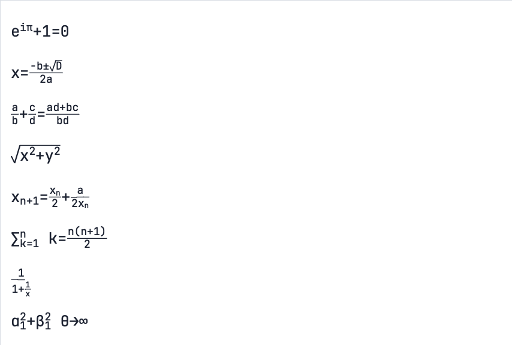
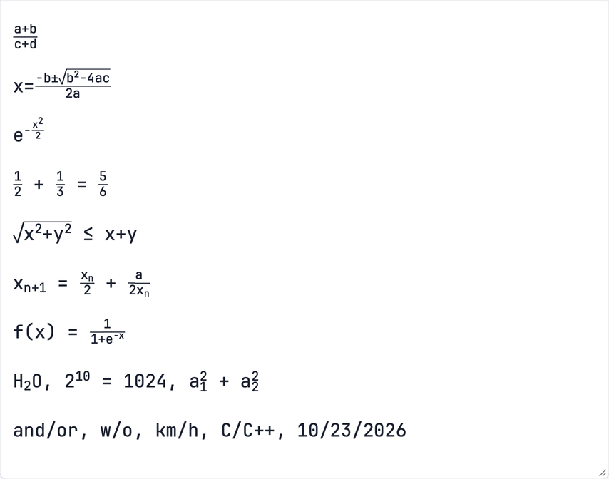

# Fontlex

**Compilers that target fonts.** Type `(a+b)/(c+d)` into a plain text box
and a fraction appears. Type `**bold**` and the asterisks disappear as the
word turns bold. Type Python and it is highlighted, with a bar under every
character past column 79. There is no JavaScript and no editor plugin: the
font does it. Fontlex compiles lexers, GitHub Flavored Markdown, a math
layout model and pronunciation dictionaries into OpenType fonts, and the
text shaper that every browser and operating system already has runs them,
on every keystroke.

[](https://github.com/fMindstormer/fontlex/actions/workflows/checks.yml)
[](LICENSE)

**[Try the live demos](https://fmindstormer.github.io/fontlex/)** · [Download the fonts and the browser extension](https://github.com/fMindstormer/fontlex/releases/latest)

<table>
<tr><td><a href="https://fmindstormer.github.io/fontlex/python.html"></a></td>
<td><a href="https://fmindstormer.github.io/fontlex/markdown.html"></a></td></tr>
<tr><td><a href="https://fmindstormer.github.io/fontlex/english.html"></a></td>
<td><a href="https://fmindstormer.github.io/fontlex/french.html"></a></td></tr>
<tr><td><a href="https://fmindstormer.github.io/fontlex/german.html"></a></td>
<td><a href="https://fmindstormer.github.io/fontlex/german-syllables.html"></a></td></tr>
<tr><td><a href="https://fmindstormer.github.io/fontlex/math.html"></a></td>
<td><a href="https://fmindstormer.github.io/fontlex/relaxed-math.html"></a></td></tr>
</table>

Every image is a plain text box; the colors, the hidden Markdown markup,
the liaison ties and the fractions are drawn by the font.

## A font is a program

A text box doesn't draw characters. It hands each run of them to a
*shaping engine* along with the font: HarfBuzz in Chrome, Firefox and
Android, Core Text in Safari and on the Mac. The engine maps the characters
to glyphs and then runs the font's lookup tables, which say how to swap
glyphs and where to put them. The tables exist so that Arabic letters can
join, Devanagari can form conjuncts and *f* and *i* can form a ligature.
They are also a small programming language, executed on every keystroke in
every text box, with no script and no permission asked.

The characters never change. Copy a typeset fraction and you get
`(a+b)/(c+d)` back; search, screen readers, `diff` and language models all
see the source. Only the drawing is computed. So Markdown stays Markdown, a
German noun keeps its letters, and a formula stays the formula you typed.

## The machine

What can that language compute? It is a strange computer, and most of the
engineering here is learning to live inside it.

The engine turns a run of text into a row of glyph ids and applies the
font's substitution lookups (GSUB) in order. Each lookup is one pass over
the row:

- A **contextual lookup** goes left to right. At each glyph a rule may read
  the glyphs behind it, the glyph itself and the glyphs ahead, and replace
  it. The glyphs behind have already been rewritten by this pass, so a
  rule can read the state the pass left on its neighbor. That is a
  finite-state machine.
- A **reverse chaining lookup** goes right to left, the mirror image: it is
  how a glyph learns about something that comes later.
- A **mark filtering set** lets a lookup see only chosen glyphs. With only
  `*` visible, an opening `*` and the next `*` are neighbors, however much
  text lies between them.
- A **multiple substitution** turns one glyph into several. Fontlex uses it
  to slip empty, invisible glyphs between characters to hold state.
- After substitution, **positioning** (GPOS) moves glyphs and hangs marks
  on base glyphs or on other marks, and **color glyphs** (COLR) paint
  outlines from a palette.

Between passes, the only memory is which glyph sits at each position. A
pass that needs to remember something writes it into the glyph: the `h` in
a string is a different glyph from the `h` in a name. They look alike, but
the next rule can tell them apart.

```
characters   p  r  i  n  t  (  "  h  i  "  )
state        N  N  N  N  N  O  S  S  S  S  O     N name, O operator, S string
```

Each glyph above is its character's variant for that state, colored as
that kind of token.

Put together, that is a precise class of computation. **A font computes
exactly the rational functions of a run**, the transformations that a
finite-state transducer can do. Every pass is one, compositions of them
stay one, and by Elgot and Mezei's theorem (1965) any of them can be done
by a right-to-left pass followed by a left-to-right one. A font can't count,
decide whether brackets balance, reverse a word or see the next line. Any
lexer, any bounded grammar and any finite-state transliteration, given
enough glyphs, fits in a font with one change of direction.

"Given enough glyphs" is where it gets hard. The format's real budgets are
much tighter than the theory:

| Budget | Limit | What it costs |
|---|---|---|
| Glyph ids | 65,535 per font | every state a pass remembers costs a copy of each character it can be on |
| The lookup list | about 4,700 lookups, about 6,550 subtables per lookup | 16-bit offsets: OpenType says 65,535 lookups, the bytes allow far fewer |
| Engine work | HarfBuzz: about 4,096 operations per character, nesting 64 deep | every pass visits the whole run |
| Where a run ends | decided by the browser | Chrome starts over at every tab and change of script; Core Text's line API applies no GSUB past 10,240 characters |

Glyphs are the scarce resource and passes the cheap one, so a font
compiler's main job is to trade states for passes: to cut one big machine
into a chain of small ones. [theory/README.md](theory/README.md) works this
out in full, with measurements: how a search finds such cuts, why a check
digit mod 97 can't be cut, and how a font matches brackets 4,000 deep
although it can't count.

## Building syntax out of it

### Lexing: state in the shape of a letter

The simplest compiler, `fontlex.py`, takes a lexer written as a YAML spec
and makes one variant of each character for each state it can be in. One
contextual lookup then runs the lexer's transition table: "after a glyph
in state *s*, a character of class *c* becomes its variant for state *t*".
Each variant is painted in its token's color. That is Fontlex Python and
JavaScript. The JavaScript lexer tells a regex from a division by
remembering whether a value came last, across spaces and comments.
([specs/README.md](specs/README.md) is the reference.)

Python's ruler shows the trade in miniature. A bar under every character
past column 79 needs a counter on every character. On variants of
JetBrains Mono's 1,363 characters, its 81 states would take 110,403
glyphs, more than a font can have. Instead, an empty glyph after each
character holds the count, units mod 10 and then tens: 19 states, 199
glyphs.

### Markdown: one change of direction

Markdown is harder, because whether `*` opens emphasis depends on what
comes after it, and whether a backtick opens code depends on what came
before. Fontlex Markdown runs CommonMark's inline rules as right-to-left
passes followed by left-to-right ones: one change of direction, and
[markdown/README.md](markdown/README.md) shows that it can't be done in
one direction. GitHub's extensions add six more changes, to save glyphs.

Emphasis is matched in *rounds*. Each round sees only the unmatched
delimiters, through a mark filtering set, and pairs every opener with the
closer right after it. Matched pairs leave the view, so the next round
matches the next level out. One pass that kept a stack of three openers
would need about 14,000 states, on copies of every character; six rounds
need a few states each. Link destinations, which one pass would read with
364 states, are eight passes of 6 to 35. The whole font is 151 lookups (1,945
counting nested ones) and uses 63,367 of OpenType's 65,535 glyph ids.
Within its bounds it renders every one-line CommonMark spec example, and
10,723 lines of real documents, exactly as GitHub does.

### Math: layout from substitutions

Fontlex Math typesets `\frac{a}{b}`, `\sqrt{x}`, `x^{n+1}` and `x_1^2`
with nothing but substitution and mark attachment, with no math engine
behind it. Every character is followed by four empty marks, *tracks*, each
a separate scratch memory that a pass reads and writes. 238 passes, written
as Python functions with a simulator, work out:

- what each brace opens;
- which constructs are complete, a level at a time from the inside;
- each character's size and height;
- how wide every numerator and denominator is.

Adding whole widths in one pass would take rules for every width, so they
are added in two base-16 digits: one pass for the low digits, leaving each
glyph its carry, one for the high digits. Inside a fraction nothing
advances: every glyph is a mark chained to the one before it, and invisible
*movers* carry the chain up to the numerator, back over the bar and down to
the denominator.

The first compiler needed 178,000 lookup subtables, where the format
allows a few thousand lookups. Class-based rules, one pool of nested
lookups shared by every pass, and a two-step substitution for glyphs with
too many possible successors brought it to 1,097 lookups
([math/README.md](math/README.md)).

### Relaxed math: a compiler front end, inside a font

Fontlex Relaxed Math reads math the way people type it in a chat or a
commit message: `(a+b)/(c+d)`, `x^2`, `sqrt(b^2-4ac)`. It doesn't lay out
anything itself. 122 passes in front parse the plain text and rewrite it,
inside the font, as the LaTeX that Fontlex Math already knows how to lay
out: `(a+b)/(c+d)` becomes `\frac{a+b}{c+d}`, with the parentheses as the
braces. What the line doesn't have, the `\frac` and the braces around `1`
and `2` in `1/2`, is inserted as glyphs that draw nothing. It is a compiler
front end and back end, both running in the text engine.

The hard part is restraint. A font like this runs on every line of every
text box it's used in, and prose is full of slashes: `and/or`, `w/o`,
`km/h`, `10/23/2026`, `s/x/y/g`. The rules for what counts as math were
checked against 461,327 lines of macOS man pages and READMEs, of which
311 get a construct, about half of them real math. The first build of this font
needed 113,000 glyphs, because every combination of the passes' results
became a glyph of its own. Moving results onto scratch tracks and giving
dead values' glyphs back brought it to 55,176.

### Learner fonts: data, then compilation

The learner fonts compile data instead of grammars. English and French
pronunciation hints come from aligning spellings with CMUdict and Lexique
pronunciations by hard EM: which letters are silent, which vowel takes the
stress, where French liaison is obligatory (*les‿amis*, but not *les
héros*). German nouns are colored by gender from lists learned from a
treebank, and German syllables by TeX's hyphenation patterns. The
pronunciation lexicons compile to class-based context rules, so their glyph
count doesn't grow with the word list, and the German gender font matches
32,000 whole words and endings.

Where a font can't decide (is *record* a noun or a verb?), a tagger that
reads the whole sentence puts an invisible variation selector after the
word, and the font draws that reading ([markers/](markers/README.md)).
Other fonts show nothing.

## How we know it works

A font that looks right on a demo page proves little: the interesting
failures are on the line nobody tried. So every font is compiled from, and
checked against, a reference model written separately in Python: the
lexer's DFA, ports of commonmark.js and cmark-gfm, a layout model for the
math fonts. Each check shapes thousands of lines (20,000 random ones, every
spec example, every DFA transition, real documents) in both HarfBuzz and
Core Text, and compares every glyph, or for the math fonts every glyph's
position to the font unit. The math fonts are also screenshotted in Chrome
and WebKit, and compared pixel by pixel with their outlines drawn where
HarfBuzz places them. CI rebuilds every font and page and fails unless the
result matches the repository byte for byte.

That checks the compiler, not the data. A font that does exactly what its
lexicon says is only as right as the lexicon. The German fonts are scored
on held-out text, and the reading markers on treebanks. The English and
French hints have not been reviewed by fluent speakers yet; their review
sheets are ready.

**It found an engine bug.** Compiled fonts reach places hand-drawn fonts
don't. The proportional Markdown font failed only in HarfBuzz, on lines
like `<a>x`. HarfBuzz 12.3.1 and later never matched glyph ids 32,512 to
32,767 in format 2 context rules, because of a flaw in a new coverage
cache. It was bisected to one commit and reported
([harfbuzz/harfbuzz#6418](https://github.com/harfbuzz/harfbuzz/issues/6418)),
and the fix was merged the same day
([#6419](https://github.com/harfbuzz/harfbuzz/pull/6419)) and released in
HarfBuzz 15.0.0. Until browsers ship it, Fontlex's builds pad such glyphs
out of the window.

## Prior art, and where this stands

Fonts have been made to do surprising things for a while.
[Sans Bullshit Sans](https://pixelambacht.nl/2015/sans-bullshit-sans/)
(2015) replaces buzzwords with a ligature,
[AtF Spark](https://github.com/aftertheflood/spark) (2017) draws sparklines
from numbers, [Numderline](https://github.com/trishume/numderline) groups
digits, and [Fontemon](https://www.coderelay.io/fontemon.html) (2021) is a
whole game. Code fonts like [Fira Code](https://github.com/tonsky/FiraCode)
use contextual alternates for ligatures. Fontlex comes out of the same
tradition and uses the same tables.

**On what fonts can compute.** Matthew Skala
([2010](https://ansuz.sooke.bc.ca/entry/131)) pointed out that GSUB only
moves forward and compared it to a finite-state transducer. The Litherum
blog's [Addition Font](https://litherum.blogspot.com/2019/03/addition-font.html)
(2019) added numbers in GSUB and argued that recursive lookups make GSUB,
as HarfBuzz and Core Text run it, Turing complete; the font ran on a
HarfBuzz built with its recursion limits raised. Stock engines bound
recursion, which brings real fonts back to the finite-state world.
[llama.ttf](https://github.com/fuglede/llama.ttf) (2024) runs a language model in a font through HarfBuzz's experimental
WebAssembly shaper, which leaves OpenType's tables behind and isn't enabled
in browsers. Fontlex stays inside the tables every engine runs.
[theory/README.md](theory/README.md) gives the exact class under engines'
limits, rational functions with one change of direction enough, and
measures the budgets that decide what fits. Apple's
[morx](https://developer.apple.com/fonts/TrueType-Reference-Manual/RM06/Chap6morx.html)
tables and SIL's [Graphite](https://graphite.sil.org/) put finite-state
machines in fonts by design. They run in fewer places than GSUB, and
Fontlex drops a base font's `morx`, which Core Text would run instead of
its GSUB.

**On highlighting.** Heikki Lotvonen's [font with built-in syntax
highlighting](https://blog.glyphdrawing.club/font-with-built-in-syntax-highlighting/)
(2024) colors HTML, CSS and JavaScript with contextual alternates and
COLR, from hand-written patterns: keywords, names up to 25 characters
long, and comments carried forward glyph by glyph. K. V. Rajeesh and C. V.
Radhakrishnan's [font with TeX syntax highlighting](https://tug.org/TUGboat/tb46-2/tb143rajeesh-colorfont-syntax.pdf)
(TUGboat 46:2, 2025) brings the idea to TeX and LaTeX. Fontlex compiles a
whole lexer from a spec instead, and checks every glyph against it.

**On math.** TeX and browsers' MathML lay out math with a layout
engine. An OpenType
[MATH](https://learn.microsoft.com/en-us/typography/opentype/spec/math)
table gives that engine the font's measurements, and the engine does the
layout. Many text fonts have a `frac` feature, which sets digits around a
slash as a small fraction, where the text turns the feature on. The
relaxed notation follows plain-text math that people already write, as
[AsciiMath](https://asciimath.org/) and Murray Sargent's
[UnicodeMath](https://www.unicode.org/notes/tn28/) define it; those are
parsed by a script or by Office's equation editor. Here the font parses it
and lays it out.

**What's new.** As far as we've found, no earlier font renders Markdown,
or lays out fractions and roots on its own. What makes these fonts
possible is treating the font as a compilation target: an optimizing
compiler that spends passes to save glyphs, matches nested structure in
rounds, does arithmetic on layout, and keeps within the lookup list, with
an independent reference model to check every glyph in two engines. If you
know of earlier work we've missed, please open an issue.

## The fonts

| Font | What the shaper does | Measured |
|---|---|---|
| [Python](https://fmindstormer.github.io/fontlex/python.html), [JavaScript](https://fmindstormer.github.io/fontlex/javascript.html) ([README](specs/README.md)) | runs a lexer compiled from a YAML spec and colors each token; Python also puts a bar under every character past PEP 8's 79 columns | every glyph's state matches a reference lexer: 20,000 random strings, every transition, every spec example; the ruler's bars on 2,007 lines; HarfBuzz and Core Text |
| [Markdown](https://fmindstormer.github.io/fontlex/markdown.html) ([README](markdown/README.md)) | renders GitHub Flavored Markdown line by line: CommonMark's inline rules, strikethrough, autolinks, block markup; markup hidden; mono and proportional | within its bounds, every one-line spec example, 20,000 random lines and 10,723 lines of real documents exactly as GitHub renders them |
| [Math](https://fmindstormer.github.io/fontlex/math.html) ([README](math/README.md)) | typesets a small subset of LaTeX as you type: fractions, square roots, superscripts and subscripts, Greek letters and symbols, nested 3 deep | 20,000 random lines laid out to the font unit as a separate layout model says, in HarfBuzz and Core Text; Chrome and WebKit checked by screenshot |
| [Relaxed math](https://fmindstormer.github.io/fontlex/relaxed-math.html) ([README](math/README.md#the-relaxed-notation)) | typesets math as people type it in plain text, `(a+b)/(c+d)`, `x^2`, `sqrt(x)`, and leaves prose alone: `and/or`, `w/o`, dates and paths stay text | the same, against a model of the notation; of 461,327 lines of man pages and READMEs, 311 get a construct, about half of them real math |
| [German genders](https://fmindstormer.github.io/fontlex/german.html) ([README](german/README.md)) | colors nouns by gender, from lists learned from a treebank and Wiktionary | on held-out newspaper text, 97% of nouns colored, 99.5% of them right |
| [German syllables](https://fmindstormer.github.io/fontlex/german-syllables.html) ([README](german/syllables/README.md)) | colors syllables in turn, as German schools teach reading | 97.5% of held-out first-reader words split exactly right |
| [English pronunciation](https://fmindstormer.github.io/fontlex/english.html) ([README](english/README.md)) | marks stressed and reduced vowels and silent letters of 30,000 words; noun/verb pairs read the word before (*the record*, *to record*) or an invisible [reading marker](markers/README.md); a stylistic set turns each kind of hint off | 170,817 of 170,817 cases as the lexicon says, in HarfBuzz and Core Text; the lexicon awaits review by fluent speakers |
| [French pronunciation](https://fmindstormer.github.io/fontlex/french.html) ([README](french/README.md)) | marks silent letters, nasal vowels, droppable schwas and obligatory liaison (*les‿amis*, but not *les héros*) for 30,000 words; reading markers as in English; a stylistic set turns each kind of hint off | 202,190 of 202,190 cases as the lexicon says, in HarfBuzz and Core Text; the lexicon awaits review by fluent speakers |
| [Browser extension](extension/README.md) | draws any web page in a learner font, matched to the page's language | 21 checks in Chromium and the same 21 in Firefox, including a page with a strict CSP and hiding each kind of hint |

## Quick start

```sh
pip install -r requirements.txt
python fontlex.py specs/python.yaml --base fonts/JetBrainsMono-Regular.ttf --out build
python test_fontlex.py specs/python.yaml build/Fontlex-Python.ttf --base fonts/JetBrainsMono-Regular.ttf
python demo/build_demo.py specs/python.yaml --base fonts/JetBrainsMono-Regular.ttf --out demo/fontlex-demo.html
```

Then use the font in CSS:

```css
@font-face { font-family: "Fontlex Python"; src: url(Fontlex-Python.woff2) format("woff2"); }
textarea { font-family: "Fontlex Python", monospace; font-palette: light; }
```

`./check.sh` builds all ten fonts and the demo pages and runs every check
the machine supports; `./check.sh markdown` (or `unit`, `python`,
`javascript`, `german`, `syllables`, `math`, `english`, `french`, `extension`, `theory`) runs some of it.
On macOS, `pip install -r requirements-macos.txt` adds the Core Text
(Safari, native apps) and WebKit checks. The German treebank scores need
data that isn't in the repository (`german/fetch_ud.sh german/data`);
without it that step is skipped. A full run rebuilds every tracked font and
page byte for byte, so `git status` afterwards shows nothing.

## Layout

| Path | What it is |
|---|---|
| `fontlex.py`, `test_fontlex.py`, `specs/`, `demo/` | the lexer compiler ([specs/README.md](specs/README.md)), its tests, example specs, demo pages |
| `german/` | German noun gender (lists learned from a treebank and Wiktionary) and `german/syllables/` |
| `markdown/` | the GitHub Flavored Markdown font: model, compiler, verification, demo |
| `math/` | the math fonts, LaTeX and the relaxed notation: layout models, passes with a simulator, compiler, verification, demos |
| `english/` | the English pronunciation-hint font: aligner, lexicon, compiler, verification, demo, review sheet |
| `french/` | the French pronunciation-hint font, with liaison: aligner, lexicon, compiler, verification, demo |
| `markers/` | invisible reading markers for noun/verb pairs, and a spaCy script that adds them |
| `extension/` | a browser extension that draws web pages in the learner fonts, with its Chromium and Firefox test |
| `docs/images/` | the screenshots above, of the demo pages in WebKit |
| `.github/workflows/` | CI (`./check.sh` on Ubuntu, byte-identical rebuild) and the GitHub Pages deploy |
| `theory/` | what font compilation can reach, with the experiments behind it |
| `fonts/` | base fonts (JetBrains Mono, Noto Sans subset) and their licenses |
| `build/` | the compiled fonts, TTF and WOFF2 |
| `tests/` | unit tests (`python -m unittest discover -s tests`) |

## Open questions

- **How many passes does a given computation need?** For CommonMark's
  inline syntax the answer is one change of direction, and that is the
  least possible. In general, which languages can k contextual lookups of
  bounded context recognize? This relates to locally testable languages
  and sliding-window automata.
- **Which cut is cheapest?** `theory/split.py` and `theory/cascade.py`
  search the ways to cut a machine into passes for small machines. Larger
  ones, like Markdown's raw HTML, need a heuristic.
- **Fewer glyphs per state.** Almost all variants belong to states that any
  character can enter, and each such state costs a full copy of the font's
  characters. Keeping state on empty glyphs of its own makes the cost a sum
  instead of a product, at a price in time; for Fontlex Markdown that price
  is unmeasured.
- **More engines.** Nothing here is checked on Windows (DirectWrite) yet.

## License

The project's own code and documentation are under the MIT License
(`LICENSE`). The rest keeps its own terms:

- **Base fonts**, under the SIL Open Font License 1.1: JetBrains Mono in four
  styles (`fonts/OFL.txt`) and Noto Sans, instanced and subset in four styles
  (`fonts/OFL-NotoSans.txt`). The fonts in `build/` and those embedded in the
  demo pages are modified versions of them, renamed, under the same license.
- **German lists** (`german/lexicon/`) are derived from CC BY-SA 4.0 data, so
  sharing the German gender font also takes attribution and CC BY-SA 4.0 (see
  [german/README.md](german/README.md#data-and-licenses)). The syllable
  patterns come from TeX's hyph-de under the MIT License
  (`german/syllables/hyph-de-1996.LICENSE.txt`).
- **Markdown spec examples**: `markdown/spec-0.31.2.json` (CommonMark) and
  `markdown/gfm-spec-0.29-extensions.json` (GitHub Flavored Markdown), under
  CC BY-SA 4.0 (`markdown/SPEC-LICENSE.txt`).
- **English lexicon** (`english/lexicon/`): pronunciations derived from the
  CMU Pronouncing Dictionary under its BSD-style license
  (`english/lexicon/CMUDICT-LICENSE.txt`); words chosen by wordfreq's
  frequency ranking (data CC BY-SA 4.0); the noun/verb pair list is taken from
  Wikipedia's "Initial-stress-derived noun" (CC BY-SA 4.0).
- **French lexicon** (`french/lexicon/`): derived from Lexique 3.83 and, for
  h aspiré, French Wiktionary, both CC BY-SA 4.0, so sharing the French font
  also takes attribution and CC BY-SA 4.0 (see
  [french/README.md](french/README.md#licenses)).
